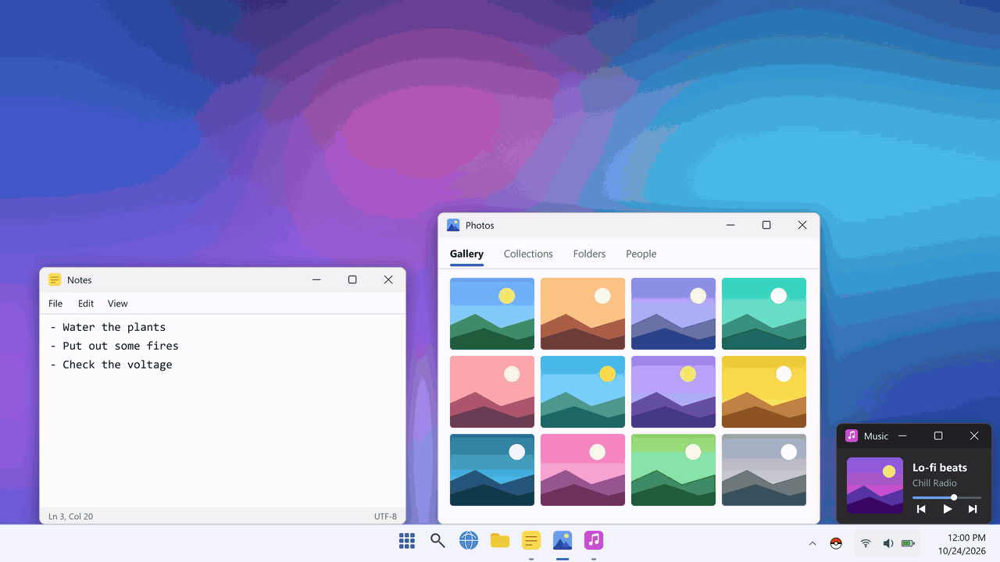
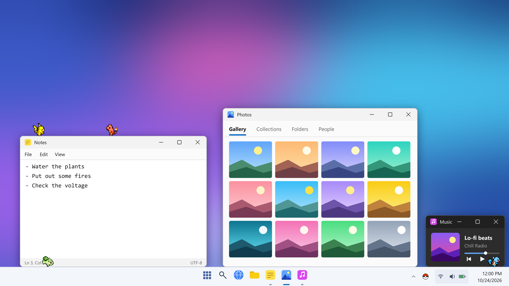
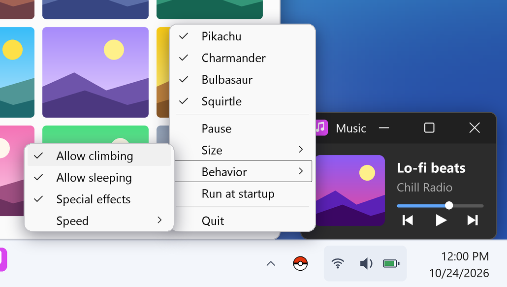

# Poke Monitor

A little desktop pet toy for Windows, in the spirit of the classic 1995 **eSheep**,
starring **poke pets**: small creatures that drop onto your screen, wander along the
taskbar, climb up the sides of your windows, stand on top of them, nap, and let you
pick them up and drop them somewhere else. Every now and then they show off their
powers: electric sparks, whipping vines, a squirt of water, a flickering tail flame.



*Poke pets dropping onto a demo desktop, walking along the taskbar, climbing a small
window, napping and showing off their special effects.
[Download the full-quality video](docs/demo.mp4) (MP4, 1.7 MB).*



*Two poke pets standing on top of a window while two more walk along the taskbar.*

## Install (Windows 10 / 11)

1. [Download **Poke-Monitor.exe**](https://github.com/appuruguru/poke-monitor/releases/latest/download/Poke-Monitor.exe).
   (On the [release page](../../releases/latest) it's listed under **Assets**; the
   "Source code" zips next to it are not the app.)
2. Double-click it. There is nothing else to install, since Python and everything it
   needs are bundled inside. The first launch downloads the sprites (about 200 KB,
   internet needed once); after that it works offline.
3. Look for the pokeball icon in the system tray (you may need to expand the
   `^` overflow; drag the icon onto the taskbar to keep it in view) to control it.

> **"Windows protected your PC"?** The exe isn't code-signed (that costs money),
> so SmartScreen warns about unknown publishers. Click **More info → Run anyway**.
> The full source is in this repo if you'd rather build it yourself (below).

## Controls

- **Drag** a pet with the left mouse button to pick it up; release to drop it.
- **Right-click** a pet to remove just that one.
- **Right-click the tray icon** to:
  - toggle which poke pets are on your desktop
  - **Pause / Resume** all movement
  - change **Size** (Small / Normal / Large) live
  - tweak **Behavior**: allow climbing, allow sleeping, special effects, speed (Slow / Normal / Fast)
  - toggle **Run at startup**
  - **Quit**



*The tray menu, with the Behavior submenu open.*

Pets that walk off either side of the screen along the taskbar come back in from
the other side. Windows hidden behind other windows (or behind a fullscreen app)
don't count as places to stand.

## What's next

More of the original 151 poke pets are on the way. The longer-term idea is to grow this
into a small game that lives on your desktop while you work: possibly battles,
evolutions, capturing new poke pets, and more. No promises on timing.

## Run from source

Needs Windows and Python 3.10+.

```bash
pip install -r requirements.txt
python run.py
```

Sprites are cached in `%LOCALAPPDATA%\Poke-Monitor\assets`.

## Build the exe yourself

```bash
pip install -r requirements.txt -r requirements-dev.txt
python scripts/build.py        # -> dist/Poke-Monitor.exe
```

### Publishing a release

Push a version tag and GitHub Actions builds the exe and attaches it to a Release
(`.github/workflows/release.yml`):

```bash
git tag v1.0.0
git push origin v1.0.0
```

## How it works

- `poke_monitor/winutils.py` — asks Windows for the work area and the top edge of
  every visible window, skipping windows hidden behind others, so pets know what
  they can stand on.
- `poke_monitor/pet.py` — one borderless, always-on-top, transparent Tk window per
  pet, with a small state machine (idle / walk / run / sleep / fall / climb / drag).
- `poke_monitor/sprites.py` — loads each poke pet's animations (standing, walking
  left/right, sleeping) and caches scaled / mirrored / rotated variants.
- `poke_monitor/effects.py` — the occasional special effects (sparks, vines, water).
- `poke_monitor/assets.py` — first-launch sprite download.
- `poke_monitor/app.py` — spawns pets, runs the shared ~25 fps tick loop, and the
  system tray icon (`pystray`, on its own thread).
- `poke_monitor/settings.py` — live-adjustable size / speed / behavior.

Speeds, gravity, climb height and how often pets sleep, run or climb are constants
at the top of `poke_monitor/config.py`.

### Adding more poke pets

Add `"name": <national-dex-number>` to `PETS` in `poke_monitor/config.py` and
restart. Its sprite is downloaded automatically and it shows up in the tray menu.

### Custom animations

While moving, pets use the SpriteCollab "Walk" animation. You can replace it with your
own: put a GIF at `%LOCALAPPDATA%\Poke-Monitor\custom\<name>\run.gif`, where `<name>` is
the pet's lowercase name as written in `PETS` in `poke_monitor/config.py`, and restart.
It must **face right**; it is mirrored for walking left. A flat single-colour background
is removed automatically, the artwork is resized to match the pet's standing sprite, and
the GIF's own frame timing is used.

This exists because some pets walk upright but run on all fours, and there is no official
or community-library sprite of that run, only fan-made pixel art that can't be
redistributed here. Bring your own favourite if you want one. Nothing in the `custom`
folder is ever touched by the sprite downloader.

## Credits and disclaimer

- The idea comes from **eSheep**, created by Tatsutoshi Nomura in 1995.
  [Adrianotiger/desktopPet](https://github.com/Adrianotiger/desktopPet) is a great
  modern revival of it. This project is an independent implementation and shares
  no code with it.
- The standing sprites are the animated Gen V sprites from the community-run
  [PokeAPI/sprites](https://github.com/PokeAPI/sprites) repo.
- The walking and sleeping sprites come from
  [PMDCollab/SpriteCollab](https://github.com/PMDCollab/SpriteCollab) (browse it at
  [sprites.pmdcollab.org](https://sprites.pmdcollab.org/)): a mix of the original
  *Mystery Dungeon* game artwork (Spike Chunsoft / Nintendo) and community fan art,
  shared for non-commercial use with credit. Credit goes to those artists; the
  per-sprite credits are saved next to each sprite in
  `%LOCALAPPDATA%\Poke-Monitor\assets\<name>\credits.txt` and listed on that site.
- All sprites are downloaded on first launch. They are **not** included in this
  repository or in the exe.
- This is an unofficial, free, non-commercial fan project. It is not affiliated with
  or endorsed by Nintendo, Creatures Inc., GAME FREAK inc. or any other rights holder
  of the characters shown. All characters, names and artwork are the property of their
  respective owners.

The source code is MIT licensed (see `LICENSE`); that license does not cover the
character sprites.
